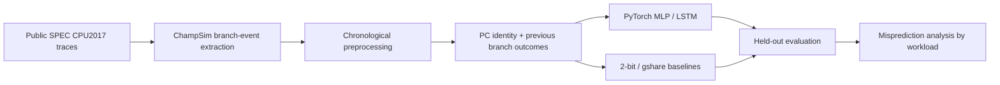

# Neural Branch Prediction with Deep Learning

**Exploring whether neural networks can learn branch behavior beyond conventional hardware predictors.**

**Project status:** Planning / pre-implementation · **Course:** APS360 — Deep Learning · **Focus:** Computer Architecture, PyTorch, Sequence Modeling

> This repository currently documents the research plan. The models, trace-processing tools, experiments, and results have **not yet been implemented or validated**. This README will be updated as development progresses.

## Overview

Modern processors predict the direction of conditional branches before their outcomes are known, allowing instruction fetching to continue without waiting for branch resolution. A wrong prediction can require discarding speculative work and redirecting the pipeline.

Traditional predictors such as **two-bit saturating counters** and **gshare** learn recurring branch behavior with compact hardware tables. This project investigates a different question: **Can a multilayer perceptron (MLP) or long short-term memory network (LSTM) use execution history to predict branch outcomes more accurately on real program traces?**

The planned work combines trace-based computer architecture analysis with supervised deep learning. It emphasizes **offline, trace-based prediction quality**, rather than claiming a hardware-ready neural branch predictor or CPU speedup.

## Proposed pipeline

### 1. Data collection and preprocessing

- Use a public version of **ChampSim** with publicly available **SPEC CPU2017 ChampSim traces**.
- Target workloads: **GCC**, **MCF**, **X264**, and **Perlbench** (subject to trace availability and processing constraints).
- Instrument conditional branch events to record the **program counter (PC)** and the **resolved direction** (*taken* or *not taken*) in execution order.
- Build samples from the current branch identity and the **preceding** `H` conditional branch outcomes, testing `H ∈ {8, 16, 32, 64}`.
- Keep workload identity associated with PC values to avoid accidentally merging identically valued addresses from different programs.

No future branch outcome will be used as an input for an earlier prediction.

### 2. Neural models

| Model | Planned architecture | Purpose |
| --- | --- | --- |
| **MLP** | Learned branch-identity embedding + binary history, followed by two ReLU fully connected layers and one output logit | Learn nonlinear relationships between branch identity and recent behavior |
| **LSTM** | Recurrent processing of the branch-history sequence, combined with a branch-identity embedding and a classification head | Study whether sequence modeling captures longer dependencies |

Both models are planned in **PyTorch**, using binary cross-entropy with logits and the Adam optimizer. If time permits, experiments may also compare **local per-branch history** against global history alone.

### 3. Conventional baselines

- **Bimodal / two-bit predictor:** A PC-indexed table of two-bit saturating counters.
- **Gshare:** A table of two-bit counters indexed using a combination of PC bits and global branch history.

Baselines will update their counters online using observed branch outcomes. Table sizes, initialization, and warm-up policies will be fixed and reported to make comparisons reproducible.

## Experimental design

Each workload will be split **chronologically** to respect execution order:

| Partition | Portion | Use |
| --- | ---: | --- |
| Training | 70% | Fit neural-network parameters |
| Validation | 15% | Tune hyperparameters and select checkpoints |
| Testing | 15% | Final, held-out comparison |

Training samples from the selected workloads will be pooled, while final results will also be shown **separately for each workload**. This is a within-workload temporal evaluation, **not** an unseen-program generalization test.

### Planned evaluation metrics

**Primary metric — conditional branch misprediction rate**

$$
\text{Misprediction rate} = \frac{\text{Incorrect conditional-branch predictions}}{\text{Total evaluated conditional branches}} \times 100\%.
$$

Additional measurements will include:

- **Prediction accuracy:** Percentage of correctly classified conditional branches.
- **Relative misprediction reduction vs. gshare:** Difference in misprediction rates, normalized by the gshare rate.
- **Model size:** Parameter count and approximate model storage.
- **Inference time:** Measured offline prediction cost.
- **Per-workload breakdown:** How results differ between compiler, memory-intensive, video-encoding, and language-processing workloads.

The neural models will be evaluated on histories reconstructed from **recorded resolved outcomes**. This does **not** simulate speculative history recovery, inference latency in a real pipeline, hardware area or energy, or cycle-level IPC improvements. Since neural models train offline and conventional baselines adapt online, conclusions will be limited to this evaluation setup.

## Research questions

1. Can learned models reduce held-out mispredictions relative to two-bit and gshare baselines?
2. How does history length (8, 16, 32, or 64 outcomes) affect MLP and LSTM predictions?
3. Does an LSTM's sequence representation help more than an MLP on particular workloads?
4. What are the trade-offs between accuracy, parameter count, and offline inference time?

## Development roadmap

- [ ] Set up a clean, public ChampSim environment and select benchmark traces.
- [ ] Extract and validate ordered conditional-branch records.
- [ ] Implement chronological splitting and leakage-safe history construction.
- [ ] Implement and verify two-bit and gshare reference predictors.
- [ ] Implement, train, and tune the MLP.
- [ ] Implement, train, and tune the LSTM.
- [ ] Compare history lengths and evaluate held-out results per workload.
- [ ] Publish reproducible configurations, figures, and a results discussion.

## Results

**No experimental results are available yet.** This section will be populated only with measurements produced by actual runs, including the benchmark, data split, model configuration, and evaluation conditions.

## Technology stack

**Python · PyTorch · C++ · ChampSim · NumPy · Git · CPU Branch Prediction**

## Data and reproducibility

- Raw SPEC traces will **not** be committed to this repository. Users should obtain them from their original source under the applicable terms.
- Scripts, configuration files, and model artifacts will be added as they are developed and verified.
- No course-restricted starter code or private benchmark materials will be published.

### Resources

- [ChampSim — official GitHub repository](https://github.com/ChampSim/ChampSim)
- [ChampSim documentation](https://champsim.github.io/ChampSim/)
- [SPEC CPU2017 ChampSim traces (Zenodo, DOI: 10.5281/zenodo.10960004)](https://zenodo.org/records/10960004)

---

*This repository tracks an APS360 deep-learning project at the University of Toronto. The methodology and milestones may evolve as experiments are implemented.*
